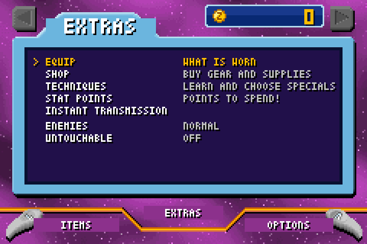
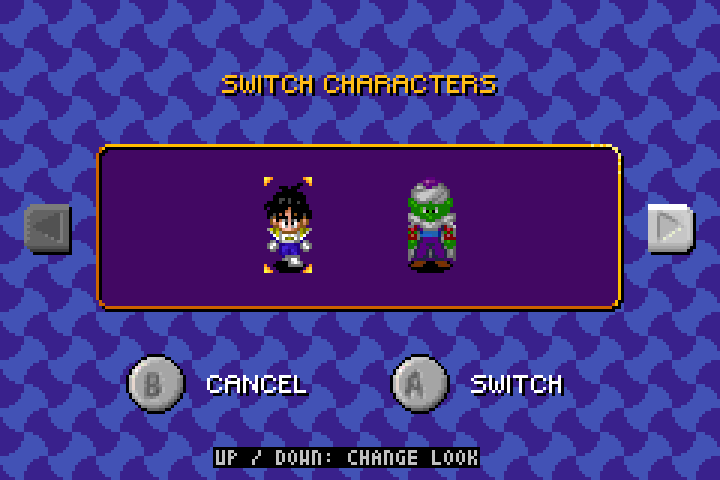
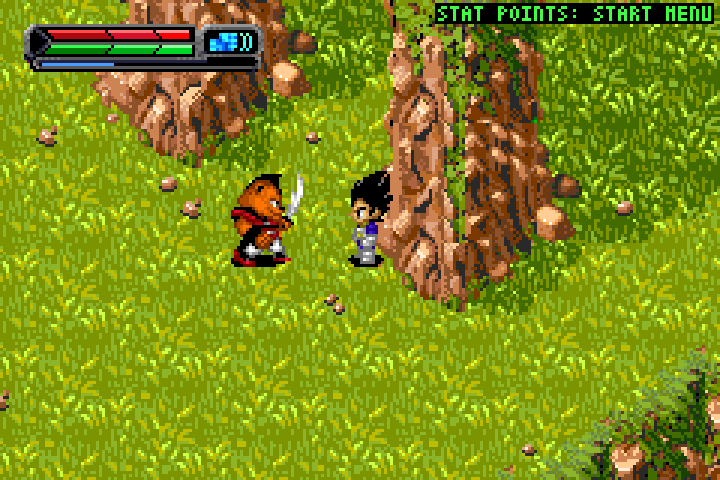

<h1 align="center">Legacy of Goku II Recomp</h1>

<p align="center"><i>Dragon Ball Z: The Legacy of Goku II</i> (Game Boy Advance, 2003), statically recompiled into a native Linux program, with mods that bring the best of Buu's Fury into it: fusions, new characters and outfits, a shop and equipment, stat points and a higher level cap, Instant Transmission, boss fights, Buu's Fury's own areas, and more.</p>

<p align="center">
  
  
  
</p>

> **You need your own copies of the games.** Nothing from either cartridge is in this repository or in the program it builds. Your Legacy of Goku II ROM is needed to build and again every time the game starts (its SHA-1 is checked; no other dump runs), and your Buu's Fury ROM is what the characters, outfits, areas and bosses below are converted from.

## What the mods add

None of it is on a keyboard key: everything is reached through the game's own screens with the game's buttons.

- **An Extras page in the Start menu**, between Items and Options: Equip (what is worn, on Buu's Fury's Equip screen), a shop for gear, learning any other character's special attack (into a third slot of your own), a full restore, stat points to spend, Instant Transmission to any place the world map allows, enemy toughness, and an "untouchable" switch.
- **Progression.** Stat points on level-up, stats to 200, level cap 100, five levels for the three-year time skip. Enemy health bars, damage numbers, zenie from beaten enemies.
- **Fusions.** L goes on past the last attack to the fusions, as in Buu's Fury, with the partner and the dance: Gogeta and Vegito for Goku and Vegeta, Gotenks for kid Trunks, each with the fusion's own two special attacks captured out of Buu's Fury.
- **Looks.** Up and Down on the Switch Characters screen change a character's outfit, remembered: adult Gohan (with the Mystic transformation and his own portraits), the Great Saiyaman with and without the helmet, Super Saiyan 3 Goku, Vegeta in his Buu-saga clothes and as Majin Vegeta, kid Trunks, Goku's halo once the story has him die.
- **Buu's Fury's areas and Heaven**, reachable by Instant Transmission; **boss fights** against the game's own bosses and Majin Buu's four forms in Majin Buu's battleground.
- **Combat.** Hold R to guard. Gohan's gold Kamehameha from the start and a Masenko that works as in Buu's Fury. Slow health regeneration; the Capsule Corp pad restores health and energy.
- **The world.** Camps with a save pad at a few fixed spots, glowing flight pads, the seven missing Namekians counted as found.
- **From the runtime:** save states on F5/F8, quit-and-resume, rolling crash snapshots, a diary of what the game does, and picture modes (original, xBRZ, HD redraw by a neural network on the GPU; scanlines or an LCD grid; colour correction). Game controllers work.

## Building it

A Debian/Ubuntu-like Linux on x86-64 with gcc, g++, make, cmake, git, python3 with Pillow, and the SDL2 runtime installed; a Vulkan-capable GPU for the HD picture mode.

```sh
./setup.sh                        # fetches and builds mGBA, xBRZ, ncnn and the rest under deps/, no root needed
nano games/lgoku2/game.mk         # ROM: the path to your dump, and its SHA-1 (see below)
nano games/buusfury/game.mk       # the same for Buu's Fury
```

The mods include sprites, areas and portraits converted from Buu's Fury (`games/lgoku2/mods/generated/`, not in the repository). Until that data is there, `make` builds the bare game and says what is missing. So: build each game with the extraction aid as its only mod, have it unpack its graphics, run the converters, then build for real:

```sh
make GAME=lgoku2 MODS=tools/mods/extract.c
EXTRACT_FN=0801F845 EXTRACT_LIST=tools/sprites/graphics-lists/lgoku2.txt EXTRACT_OUT=build/sprites/lg2 ./lgoku2 --headless 200
make GAME=buusfury MODS=tools/mods/extract.c
EXTRACT_FN=0803D941 EXTRACT_LIST=tools/sprites/graphics-lists/buusfury.txt EXTRACT_OUT=build/sprites/bf ./buusfury --headless 200
tools/sprites/make_converted_sprites.sh      # the converted sprites and portraits into games/*/mods/generated/
make GAME=lgoku2 && make GAME=buusfury       # with the mods
./lgoku2 --scale 4
```

Run the extractors with the game in play (`--load-state` of a state saved with F5) so the palette they also write is the in-game one. A few pieces (the fusions' attacks, the dances, the Equip screen backdrop, the camp pad, the portraits) are captured from the games being played, by the scripts next to the converters; each says what it needs. The mods lean on each other, so the game stays bare until every piece is there.

`games/lgoku2/game.mk` as committed names an SRAM-patched dump (`SAVE_MEMORY := SRAM`); with a clean cartridge dump, put its SHA-1 in `ROM_SHA1` and drop that line. `games/lgoku2/patches/enhanced.ips`, applied at build time, is the "Enhanced" balance hack; delete it for the original game. `make` leaves a link to your ROM at `~/.local/share/lgoku2/lgoku2.gba`, the first place the program looks; `lgoku2.gba` next to the program or `--rom FILE` work too. Keys: arrows move, X = A, Z = B, A = L, S = R, Enter = Start, Backspace = Select, Tab fast-forwards, Space skips scenes, F11 fullscreen, Esc quits. `./lgoku2 --help` lists everything.

## Under the hood

`tools/recomp.py` turns the game's ARM and Thumb code into C, one function per block, each instruction being mGBA's own interpreter body inlined with a constant opcode, so gcc compiles it into specialised native code. mGBA's core supplies the hardware (video, sound, timers, DMA, saves) with its CPU loop patched to call the compiled blocks. Mods are C files in `games/lgoku2/mods/` that hook game functions by address through the small API in `runtime/mod.h`; what has been found in the game (character records, tables, functions, the sprite format) is written down as code in `games/lgoku2/mods/lg2.h`. The full story is in [docs/PROJECT.md](docs/PROJECT.md).

The sibling for *Buu's Fury*, with online battles: [buusfury-recomp](https://github.com/Aeanobis/buusfury-recomp).

## Legal

An unofficial fan project, not affiliated with or endorsed by the games' publishers or rights holders. Dragon Ball, The Legacy of Goku II and Buu's Fury belong to their owners. This repository contains no game data; use the program with cartridges you own. Built on [mGBA](https://mgba.io) (MPL-2.0), [xBRZ](https://sourceforge.net/projects/xbrz/) (GPLv3), [ncnn](https://github.com/Tencent/ncnn) (BSD) and the Real-ESRGAN models, all fetched by `setup.sh` rather than included.

The code here is free software under the GNU General Public License, version 3 ([LICENSE](LICENSE)). Copyright (C) 2026 Aeanobis.
